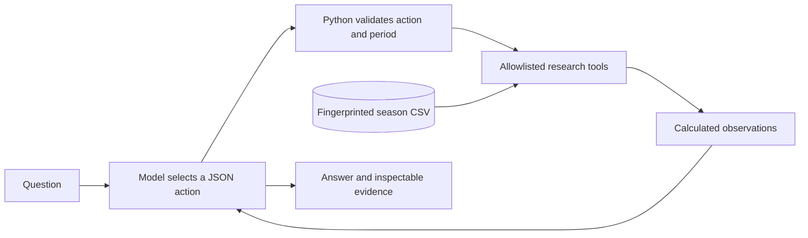
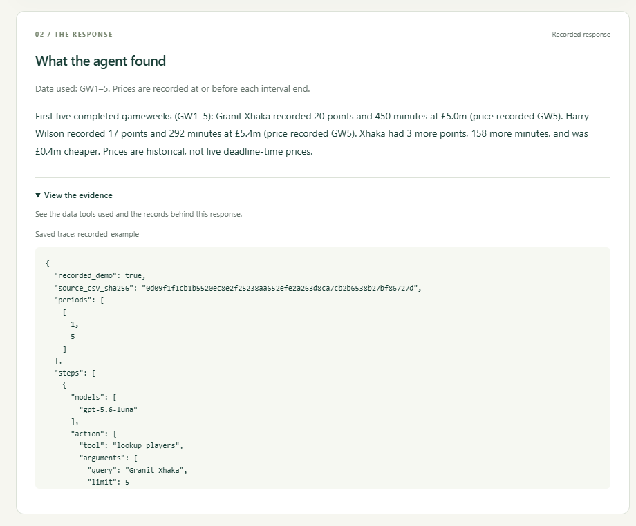

# Touchline

**Ask football questions. Inspect the evidence.**

A natural-language research agent for historical Fantasy Premier League performance, using approximately 29,700 player–fixture records from the 2025/26 season. Find budget midfielders and forwards, compare players, and explore performance over a chosen gameweek range.

**Python · JavaScript · HTML/CSS · GitHub Copilot CLI · Tool-calling agent**


*Actual interface, replaying a saved model response. The demo is labelled and makes no new model request.*

## The problem

Answering a question such as “Compare these players over the first gameweeks” means filtering fixture records, handling double gameweeks, choosing historical prices and calculating comparable statistics. Touchline puts that workflow behind a question box and exposes the calculations used to answer it.

It supports historical research in the saved season. It does not forecast future returns, retrieve live injuries or optimise transfers. Time savings and decision benefits have not been measured.

## How it works



The model chooses tools; Python calculates the statistics. The controller validates arguments, rejects unknown tools and protects recognised period requests. Player comparisons use IDs already observed through tools. The browser shows the actual tool periods separately from the answer, and an evidence panel exposes the actions and returned records.

The data layer preserves distinct fixtures in double gameweeks, rejects conflicting records, evaluates prices at or before the interval end and keeps missing measurements unavailable. The agent loop bounds model requests and subprocess time. Copilot's built-in tools and MCP servers are disabled; full live traces are saved locally.

## Run the recorded demo

Requires Python 3.12+. No package installation, dataset, credentials or frontend build needed.

```bash
git clone https://github.com/SubBoc/touchline-fpl.git
cd touchline-fpl
python app/serve.py --demo
```

Open [http://127.0.0.1:8766](http://127.0.0.1:8766) and select **Replay saved research**. Inspect **View the evidence** beneath the answer. On macOS/Linux, use `python3` if that is your Python command.

The replay contains a real saved player comparison and accepts only its example question. It demonstrates the interface and evidence format, rather than running a new agent search.

<details>
<summary>See the tool evidence</summary>



</details>

## Run new questions

The fingerprinted CSV is included. Data: [Vaastav Anand / Fantasy-Premier-League](https://github.com/vaastav/Fantasy-Premier-League/tree/master/data), under the [upstream MIT licence](data/LICENSE). See [data provenance](data/README.md).

Install [GitHub Copilot CLI](https://docs.github.com/en/copilot/how-tos/copilot-cli/set-up-copilot-cli/install-copilot-cli) and [authenticate with your own account](https://docs.github.com/en/copilot/how-tos/copilot-cli/set-up-copilot-cli/authenticate-copilot-cli). Live questions use that account's allowance and require network access.

```bash
copilot login
python app/serve.py --check
python app/serve.py
```

If Copilot is outside your PATH, set `FPL_COPILOT_PATH` to its executable. The app uses only Python's standard library. The CLI adapter uses specific flags; compatibility with every future Copilot release is not guaranteed.

Try: *Find midfielders under my budget by total points over an explicit gameweek interval.* Include the position, budget and period. Each question is independent.

## Engineering and validation

Synthetic unit tests cover calculations, historical price timing, double gameweeks, missing values, period validation, rejected model actions and HTTP boundaries. A separate pandas implementation recomputes real-data rankings and comparisons without importing the app's calculation functions.

```bash
python -m unittest discover -s app -p "test_*.py"
python app/serve.py --demo --check
```

Optional real-data verification requires `pip install -r verification/requirements.txt`:

```bash
python verification/check_data_contract.py
python verification/check_intervals.py
```

To rerun the complete local verification and save a new report: `python verification/verify.py`. JavaScript syntax checking also requires Node.js.

See the [verification record](results/verification.json), generated by [verification/verify.py](verification/verify.py), and the [recorded example](results/example.json), extracted by [verification/export_example.py](verification/export_example.py). Passing checks support these cases, not a general accuracy guarantee. The period guard is not a complete language parser, and model prose can still omit or overstate evidence. Auto model routing prevents exact reproduction of wording and tool choices. Sampling seeds are not exposed by this transport.

## Project map

| Path | Purpose |
| --- | --- |
| [app/run_search_agent.py](app/run_search_agent.py) | Model policy, validated action loop and local traces |
| [app/search_tools.py](app/search_tools.py) | Deterministic research tools and metrics |
| [app/snapshot.py](app/snapshot.py) | Read-only, fingerprint-checked CSV loader |
| [app/web/](app/web/) | Responsive question, answer and evidence interface |
| [app/agent_spec.md](app/agent_spec.md) | Agent contract and limits |
| [fpl_data_taxonomy.json](fpl_data_taxonomy.json) | Field definitions, units and aggregation rules |
| [verification/](verification/) | Contract checks and separate raw-data recomputation |

Built with AI-assisted development using Codex. I chose the problem and scope, directed iterations, reviewed behaviour and spot-checked a player result against the CSV. [Short reflection →](docs/reflection.md)
